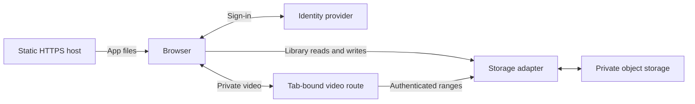
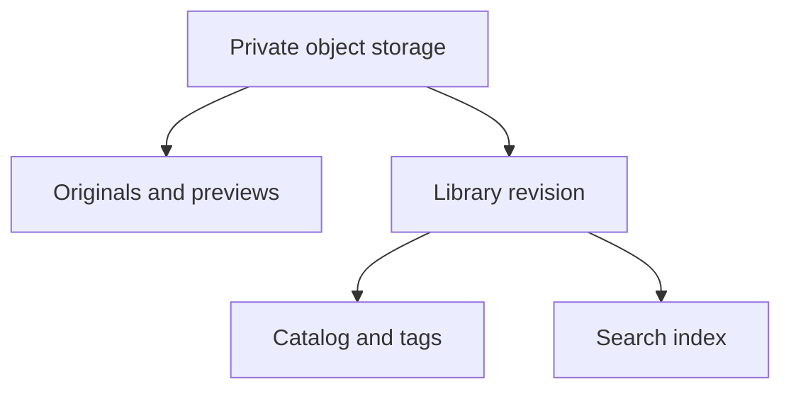

# Minnelux

[](https://github.com/ricardocabral/minnelux/actions/workflows/checks.yml)
[](LICENSE)

Minnelux is a self-hosted web app designed for browsing, searching, and organizing photos and videos in private cloud storage you control.

- **Privacy.** Your browser connects directly to your storage and identity provider.
- **Preservation.** Organize your library with tags while keeping the original files intact.
- **Portability.** Keep the catalog and search index with your media so you can reopen the library in another browser or move it to another storage provider.

## Local setup

With Node.js 22 or newer installed, clone the repository and start the catalog and search benchmark.

```sh
git clone https://github.com/ricardocabral/minnelux.git
cd minnelux
node spikes/snapshots/serve.mjs
```

Open the benchmark and select **Run benchmark** to try catalog and search with sample data. [Open localhost](http://127.0.0.1:8782/)

To import a Flickr account export into a private GCS library, use the [Flickr importer](apps/flickr-import/README.md).

For cloud setup, use a static HTTPS host, a private bucket, and provider sign-in configured for your site's origin. [Google Cloud Storage setup](docs/prod/minnelux-prd.md#google-account-sign-in-and-gcs-access) · [Amazon S3 setup](docs/prod/connect-amazon-s3.md)

## Architecture

### Browser, sign-in, and storage



The browser holds short-lived credentials in memory. Storage adapters translate provider requests and expose opaque write tokens for publishing revisions safely. The video route streams private ranges only to the tab that registered the asset. [Browser architecture](docs/prod/minnelux-prd.md#3-browser-architecture) · [S3 browser proof](spikes/s3/README.md)

### What the library stores



[Product specification](docs/prod/minnelux-prd.md) · [Contributing](CONTRIBUTING.md) · [Security](SECURITY.md)
