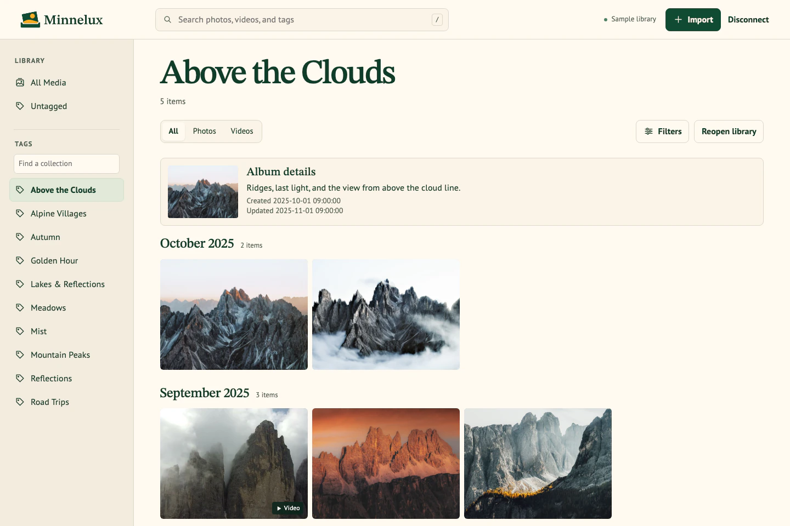

<h1>
  <picture>
    <source media="(prefers-color-scheme: dark)" srcset="docs/mkt/logo/horizontal/minnelux-dark.svg">
    
  </picture>
</h1>

Minnelux is a self-hosted web app for browsing, searching, and organizing media in private cloud storage you control. It keeps your originals and the library catalog in your bucket.

The standard app runs entirely in your browser. Self-hosting requires only static HTTPS file hosting for the app and a private cloud bucket for the library.

- **Privacy.** Your browser connects directly to your storage and identity provider.
- **Preservation.** Organize your library with tags while keeping the original files intact.
- **Portability.** Keep the catalog and search index with your media so you can reopen the library in another browser or move it to another storage provider.

## How it looks like

## Tutorial

- [Explore a sample library](docs/prod/first-library.md) to browse a Flickr album, inspect photo details, and find a photo by name without a cloud account.

## How-to guides

- [Run or self-host the web client](apps/web/README.md)
- [Connect Google Cloud Storage with Google sign-in](docs/prod/connect-google-cloud-storage.md)
- [Connect Amazon S3 with Cognito](docs/prod/connect-amazon-s3.md)
- [Keep Google libraries connected across reloads](apps/web/README.md#stay-connected-across-reloads)
- [Import or browse a Flickr account export](apps/flickr-import/README.md)

## Reference

- [Screenshots and feature reference](docs/prod/screenshots.md)
- [Library compatibility and import limits](docs/prod/library-compatibility.md)
- [Storage and library format specification](docs/dev/storage/SPEC.md)

## Explanation

- [How Minnelux connects to storage and keeps a library](docs/prod/architecture.md)

[Contributing](CONTRIBUTING.md) · [Security](SECURITY.md)
