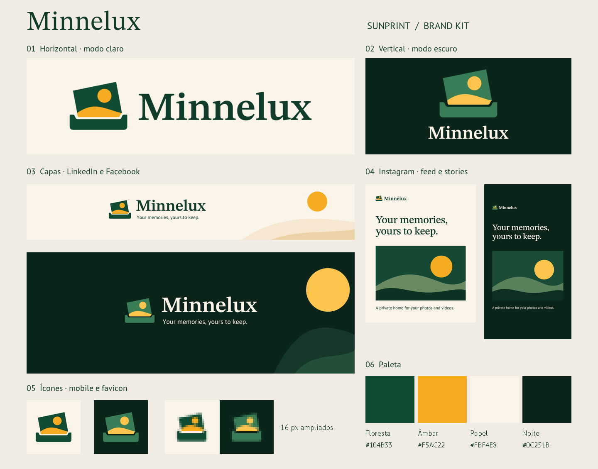

# Minnelux · identidade Sunprint

Uma fotografia iluminada saindo do estojo. A imagem associa o Minnelux à redescoberta de memórias e ao controle sobre o próprio arquivo. O produto é um aplicativo de código aberto para explorar, buscar e organizar fotos e vídeos privados no armazenamento do usuário. [PRD do Minnelux](../prod/minnelux-prd.md)

## Logos

Os SVGs têm letras convertidas em curvas. Os PNGs do logo têm fundo transparente. Escolha a versão **light** para superfícies claras e **dark** para superfícies escuras.

| Versão | SVG claro | SVG escuro | PNG |
| --- | --- | --- | --- |
| Horizontal · cabeçalhos, site e documentos | [Claro](logo/horizontal/minnelux-light.svg) | [Escuro](logo/horizontal/minnelux-dark.svg) | 320 × 88, 640 × 176 e 1280 × 352 |
| Vertical · áreas quadradas e capas | [Claro](logo/vertical/minnelux-light.svg) | [Escuro](logo/vertical/minnelux-dark.svg) | 256 × 224, 512 × 448 e 1024 × 896 |
| Símbolo · navegação móvel e espaços compactos | [Claro](logo/symbol/sunprint-light.svg) | [Escuro](logo/symbol/sunprint-dark.svg) | 64, 128, 256 e 512 px quadrados |

Use a composição horizontal a partir de 160 px de largura e a vertical a partir de 96 px. Em espaços menores, use o símbolo. Deixe ao redor da marca uma margem de pelo menos o raio do sol do símbolo. Preserve as proporções, a inclinação da foto e o espaço entre a foto e o estojo. Sobre uma fotografia ou um fundo irregular, use uma base de cor sólida da paleta.

## Mobile e favicon

| Aplicação | Arquivos | PNG |
| --- | --- | --- |
| Ícone de instalação PWA · purpose any | [SVG claro](mobile/app-light.svg) · [SVG escuro](mobile/app-dark.svg) | 192 e 512 px |
| Ícone de instalação PWA · purpose maskable | [SVG claro](mobile/maskable-light.svg) · [SVG escuro](mobile/maskable-dark.svg) | 192 e 512 px |
| Apple touch icon | [SVG claro](mobile/apple-touch-icon-light.svg) · [SVG escuro](mobile/apple-touch-icon-dark.svg) | 180 px |
| Favicon de navegador | [SVG adaptativo](favicon/favicon.svg) · [SVG claro](favicon/favicon-light.svg) · [SVG escuro](favicon/favicon-dark.svg) · [ICO](favicon/favicon.ico) | 16, 32 e 48 px |

Os ícones de instalação têm fundo sólido. No SVG adaptativo, a cor acompanha a preferência do navegador. O ICO usa a paleta clara e inclui imagens de 16, 32 e 48 px. [Ícones PWA no MDN](https://developer.mozilla.org/en-US/docs/Web/Progressive_web_apps/Manifest/Reference/icons) · [Apple touch icon](https://developer.apple.com/library/archive/documentation/AppleApplications/Reference/SafariWebContent/ConfiguringWebApplications/ConfiguringWebApplications.html)

## Redes sociais

Cada pasta contém a arte em SVG e o PNG no tamanho indicado, nos dois temas. Para publicar, use o PNG da peça. Os avatares têm margem para recorte circular.

| Canal | Peças |
| --- | --- |
| [LinkedIn](social/linkedin/) | Capa de página 1512 × 256 e avatar 400 × 400. [Especificações do LinkedIn](https://www.linkedin.com/help/linkedin/answer/a563309) |
| [Facebook](social/facebook/) | Capa de página 851 × 315 e avatar 320 × 320. |
| [Instagram](social/instagram/) | Avatar 320 × 320, feed quadrado 1080 × 1080, feed retrato 1080 × 1350 e story 1080 × 1920. |

As capas mantêm nome e assinatura na região central. Na prévia de publicação, confira a posição do recorte de capa e os controles sobrepostos ao story.

## Paleta e tipografia

| Uso | Light | Dark |
| --- | --- | --- |
| Superfície | Papel **#FBF4E8** | Noite **#0C251B** |
| Nome e texto | Verde escuro **#103D2A** | Papel **#FBF4E8** |
| Foto e estojo | Floresta **#104B33** | Verde folha **#397D57** |
| Sol e paisagem da foto | Âmbar **#F5AC22** | Âmbar claro **#FFC44D** |

O nome usa **STIX Two Text Semibold**, com ajuste de espaçamento. As peças usam **STIX Two Text Medium** nos títulos e **PT Sans Regular** no texto de apoio. [STIX Two Text](https://github.com/stipub/stixfonts) · [PT Sans](https://fonts.google.com/specimen/PT+Sans)

A assinatura das peças é **“Your memories, yours to keep.”**. A frase de apoio é **“A private home for your photos and videos.”**. As duas seguem o inglês do PRD e do README do projeto.
