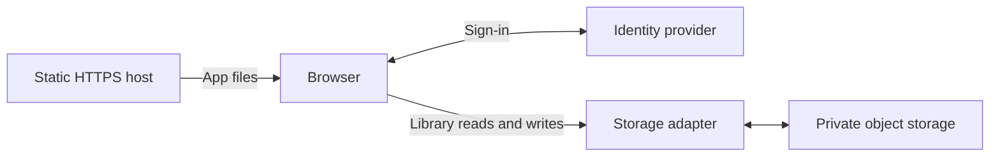

# How Minnelux works

## Browser, sign-in, and storage

The HTTPS host serves the app files. Signing in gives the browser short-lived credentials. Your storage provider uses those credentials and the bucket owner's permissions to decide whether a request can read or write library data.

With **Remember login** selected, the web client saves a short-lived Google Cloud Storage token and its library connection in the browser's IndexedDB. Reloading the same site in the same browser profile can reopen the library while the token is valid. A new Google token requires another sign-in action. [Remember a Google Cloud Storage login](../../apps/web/README.md#stay-connected-across-reloads)

For imported videos, the web client displays saved previews and details. Use the Flickr importer to download the original video. [Current viewer support](library-compatibility.md#library-formats)

## What the library stores

```mermaid
flowchart TD
    Storage["Private object storage"] --> Media["Originals and previews"]
    Storage --> Revision["Library revision"]
    Revision --> Catalog["Catalog and tags"]
    Revision --> Search["Search index"]
```

The catalog records where the media lives and which tags belong to each item. The search index helps the browser find matches without reading the originals. When you publish, Minnelux writes a new revision and updates the library head to point to it. Previews give the browser smaller files to display while the original files keep their exact bytes.

[Detailed browser architecture](minnelux-prd.md#3-browser-architecture) · [Library format](minnelux-prd.md#4-library-format)
