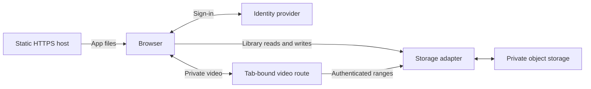
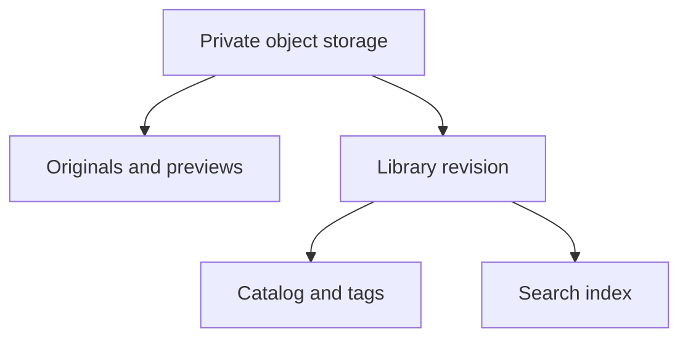

# How Minnelux works

## Browser, sign-in, and storage

The HTTPS host serves the app files. Signing in gives the browser short-lived credentials. Your storage provider uses those credentials and the bucket owner's permissions to decide whether a request can read or write library data.

With saved Google sessions, a server on the app's origin handles sign-in and token renewal so the browser can reopen the library after a reload. Library and media requests go directly from the browser to Google Cloud Storage. [Google session setup](../../apps/web/README.md#stay-connected-across-reloads)

The diagram includes the design for private video playback. The route is bound to the tab that opened the video and requests byte ranges so the player can seek. The GCS browser proof demonstrates this path. [GCS browser proof](../../spikes/gcs/README.md) · [Current viewer support](library-compatibility.md#library-formats)

## What the library stores

The catalog records where the media lives and which tags belong to each item. The search index helps the browser find matches without reading the originals. When you publish, Minnelux writes a new revision and updates the library head to point to it. Previews give the browser smaller files to display while the original files keep their exact bytes.

[Detailed browser architecture](minnelux-prd.md#3-browser-architecture) · [Library format](minnelux-prd.md#4-library-format)
