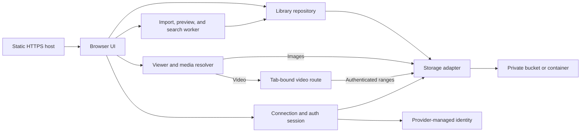

# Minnelux

**Product requirements document**

## 1. Product and scope

Build Minnelux, an open-source web app for people who want to browse, search, and organize a private photo and video archive in cloud storage they own. The owner deploys a static HTTPS site, connects a private bucket or container, imports media, and can open the same library from a fresh browser. The browser handles indexing, editing, and media viewing. Object storage holds the originals, previews, source metadata, catalog, and persisted inverted index.

The deployment consists of static app files and library objects. The web client can remember a Google Cloud Storage login across reloads until the access token expires. The browser connects directly to the identity and storage providers. The owner configures storage access and any required OAuth or identity registration. Publish the source, static build, versioned file formats, and self-hosting instructions.

The first release opens one library at a time, with one portable library per bucket or container prefix. Tags are named collections. A photo or video can belong to any number of tags without duplicating the original. Initial media support covers common browser-decodable photo and video formats. Background phone backup, external sharing, manual album ordering, and semantic search are future scope.

## 2. Requirements and acceptance criteria

| Requirement | Acceptance criteria |
| --- | --- |
| **R1. Connect private storage** | The static app can initialize and reopen a private library on Google Cloud Storage, Azure Blob Storage, Amazon S3, and Cloudflare R2. A user with read-only access can browse and search. An unauthorized session cannot read library objects. Connection errors identify credential, permission, or browser cross-origin problems where the provider exposes enough information. |
| **R2. Import photos and videos** | The owner can upload local files or catalog existing objects under a selected prefix. Uploaded originals retain their bytes. Existing objects stay in place. Imports report progress and individual errors, and retries reuse asset identities. |
| **R3. Import a Flickr archive** | The owner can import Flickr metadata and media ZIPs across sessions. A preview shows matched, pending, ambiguous, and duplicate items before writing. A match preserves the original bytes and relevant raw JSON. Available titles, descriptions, tags, capture times, coordinates, and album memberships become usable library metadata. Replaying a part preserves published asset IDs, original links, owner edits, and owner tag choices. |
| **R4. Organize with tags** | The owner can create and rename tags, apply or remove them on one or many assets, and open a collection from the tag browser or an asset. A photo or video with two tags appears in both collections by reference to one asset. Renaming a tag preserves membership and searchability. The browser includes All Media and Untagged. |
| **R5. Search** | Search queries the persisted inverted index from the bucket. It supports words in filenames, titles, descriptions, and tag names, plus filters for tags, media type, and date. A fresh authorized browser can search without listing the media prefix or indexing originals. Results belong to the same published revision as the catalog. |
| **R6. Browse previews** | A responsive thumbnail grid presents All Media, a tag collection, and search results. The grid defaults to capture-date order outside ranked search. It fetches visible thumbnails or posters and shows placeholders where needed. Originals are fetched on demand. |
| **R7. View photos and videos** | A full-screen viewer supports image zoom, video playback and seeking, and keyboard, touch, and on-screen navigation. The viewer displays title, date when known, and tags. Returning to the grid restores the collection or query and scroll position. Video starts and seeks before the full download, and its playback route is usable only from the authorized tab and session. Unsupported formats retain a download path. |
| **R8. Reopen, repair, and migrate** | A fresh browser can reopen the library and see saved edits. The owner can rebuild search from the catalog. Copying the library and referenced originals to another supported provider preserves IDs, tags, and search results after connection setup and any media-root remapping. |

## 3. Browser architecture

This section describes the product design. See [library compatibility](library-compatibility.md) for the apps, providers, and formats available in a given build.



| Component | Responsibility |
| --- | --- |
| **Connection and auth session** | Binds the provider, identity, approved endpoints, and library. Obtains short-lived credentials and handles their provider-specific expiry. Supplies the authorized adapter and session lifecycle to the app. Provider policy enforces the permitted operations. |
| **Storage adapter** | Defines paginated listing with opaque cursors, object metadata, full and range reads, uploads, and conditional writes. Returns the head body and opaque write token from the same read. Distinguishes confirmed absence, access denial, expiry, write conflict, and transport failure where the provider exposes enough information. |
| **Library repository** | Loads and pins a revision, resolves relative object keys, publishes catalog and index snapshots, and handles retries and concurrent edits. |
| **Import and preview pipeline** | Adapts local files, existing objects, and Flickr export parts into asset records. Previews a Flickr join and processes imports in bounded batches. Generates image thumbnails and video posters in the browser when the source can be decoded. |
| **Search worker** | Builds compact token and tag postings, reads the persisted index, and returns ordered asset IDs for the current filters. Rebuilds the index from the catalog when requested. |
| **Gallery and viewer** | Provides tag navigation, search, virtualized thumbnails, bulk tagging, and full-screen photo and video viewing. Resolves media using the active session and the viewer's pinned result list. |

Implement a static TypeScript single-page app. Lazy-load the selected provider adapter. Run parsing, preview generation, and indexing in browser workers where supported. Keep fetched private data in browser memory for the authorized session.

### Security requirements

- **App origin and deployment.** Treat code shipped by the static host as trusted with the active session's storage permissions. Restrict production deploy access, review and pin build dependencies, and serve app scripts and service workers from the dedicated HTTPS origin. Allow only required identity scripts and approved provider endpoints in the page and worker Content Security Policy. Disallow inline script execution and embedding the app in other sites, and set `Referrer-Policy: no-referrer` and `X-Content-Type-Options: nosniff`. Keep user-controlled files off the app origin. The deployment guide covers revoking credentials, rolling back a compromised build, and retiring its service worker. [IETF browser OAuth security](https://www.rfc-editor.org/rfc/rfc10017.html#section-5)
- **Storage isolation.** Default to one private bucket or container per library and enable provider public-access protections. Grant viewer and editor access separately using provider policies. Keep administrative and backup privileges outside the app session. A shared bucket or container is supported when the provider enforces the required listing and object permissions for each prefix. The selected library and CORS configuration govern app and browser behavior. Provider permissions govern access to stored data. Apply the same privacy boundary to originals, previews, source records, catalogs, and search indexes. [Cloud Storage IAM](https://docs.cloud.google.com/storage/docs/access-control/iam) · [S3 policy conditions](https://docs.aws.amazon.com/AmazonS3/latest/userguide/amazon-s3-policy-keys.html)
- **Session and diagnostics.** Keep credentials and presigned URLs in memory by default. Browser persistence is limited to non-secret connection settings and one Google Cloud Storage login when the web user explicitly opts in. Redact credentials, signed URLs, and private filenames, titles, and locations from logs and telemetry. Send authenticated requests only to the configured HTTPS identity and storage endpoints. Resolve provider regions and endpoints before authorization, and reject redirects to unapproved endpoints. On disconnect, expiry, or account or library switch, abort in-flight work, discard late results from the old session, and clear private data from views and app-managed caches. On credential rejection, renew through the provider if possible and otherwise request a fresh sign-in. Credential expiry and revocation follow the provider lifecycle.

### Storage providers and authentication

| Provider | Browser authentication and storage API | Conditional head write |
| --- | --- | --- |
| **Google Cloud Storage** | Obtain a short-lived Google OAuth access token through Google Identity Services. Call the native Cloud Storage JSON API using the signed-in Google account's IAM permissions. | Object generation precondition. Use `ifGenerationMatch=0` to create the head and the observed generation to update it. |
| **Azure Blob Storage** | Obtain an Azure Storage access token with Microsoft Entra ID and MSAL Browser. Use a single-page app registration with authorization code and PKCE, configure MSAL's in-memory cache, and assign data-plane roles at container scope. Disable Shared Key access on the dedicated account where compatible. [MSAL cache](https://learn.microsoft.com/en-us/entra/msal/javascript/browser/caching) · [Azure Shared Key controls](https://learn.microsoft.com/en-us/azure/storage/common/shared-key-authorization-prevent) | `If-None-Match: *` to create, or `If-Match` using the current blob ETag to update. |
| **Amazon S3** | Use Cognito managed login with a public app client and authorization code with PKCE. Exchange the user-pool ID token through an authenticated-only identity pool for temporary AWS credentials. Sign regional S3 requests with SigV4. Map intended identities to viewer or editor IAM roles and scope listing and object operations separately. [Amazon S3 setup](connect-amazon-s3.md) | Conditional PUT with `If-None-Match: *` to create or the exact quoted ETag in `If-Match` to update. |
| **Cloudflare R2** | Use S3 request signing against the R2 endpoint. Prefer externally issued temporary S3 credentials scoped to the required bucket, paths, and permissions. Keep the parent signing key outside the app. Any long-lived fallback must be opt-in, bucket-scoped, and covered by rotation instructions. A copied key remains usable until expiry or revocation. [R2 temporary credentials](https://developers.cloudflare.com/r2/api/s3/temporary-credentials/) | Conditional PUT using `If-None-Match: *` or the current ETag in `If-Match`. |

For Azure, S3, and R2, restrict permitted CORS origins to deployed app origins and document the methods and headers the browser needs. GCS JSON API endpoints use Google's default CORS response headers. Verify the provider exposes the headers the adapter needs for conditional writes and private media reads. [GCS CORS](https://docs.cloud.google.com/storage/docs/cross-origin) · [Azure CORS](https://learn.microsoft.com/en-us/rest/api/storageservices/Cross-Origin-Resource-Sharing--CORS--Support-for-the-Azure-Storage-Services) · [S3 CORS](https://docs.aws.amazon.com/AmazonS3/latest/userguide/cors.html) · [R2 CORS](https://developers.cloudflare.com/r2/buckets/cors/)

The provider adapters use native optimistic write preconditions. In S3, retain the quoted ETag as an opaque write token, keep any object version ID separate, and reconcile a `412` or conditional `409` against the current head before retrying. S3 can report `403` for a missing object when the caller lacks list permission. Surface ambiguous failures without treating a denial as an empty library. [GCS preconditions](https://docs.cloud.google.com/storage/docs/request-preconditions) · [Entra Blob authorization](https://learn.microsoft.com/en-us/azure/storage/blobs/authorize-access-azure-active-directory) · [Azure blob concurrency](https://learn.microsoft.com/en-us/azure/storage/blobs/concurrency-manage) · [Cognito temporary credentials](https://docs.aws.amazon.com/cognito/latest/developerguide/amazon-cognito-integrating-user-pools-with-identity-pools.html) · [S3 conditional writes](https://docs.aws.amazon.com/AmazonS3/latest/userguide/conditional-writes.html) · [R2 credentials](https://developers.cloudflare.com/r2/api/tokens/) · [R2 conditional writes](https://developers.cloudflare.com/r2/api/s3/conditional-operations/)

### Google account sign-in and GCS access

For bucket IAM, OAuth client registration, and connecting an app, follow the [Google Cloud Storage setup guide](connect-google-cloud-storage.md).

On a user click, the Google Identity Services token client opens Google's account and consent dialog and returns an OAuth access token to the browser. Request `devstorage.read_only` for browsing or `devstorage.read_write` for editing. Set `include_granted_scopes: false` for a read-only request and check the granted scope before enabling writes. The OAuth scope limits operations on all resources the account can access through IAM. The browser sends `Authorization: Bearer <access-token>` to the Cloud Storage JSON API. For example, `GET /storage/v1/b/{bucket}/o/{encoded-object}?alt=media` returns private object bytes when the scope and bucket IAM both allow it. Google hosts the identity flow. The app uses its public OAuth client ID and serves static files. Use the returned expiration to prompt for renewal. Request a replacement token through a new user action when needed. [Google browser token model](https://developers.google.com/identity/oauth2/web/guides/use-token-model) · [Token client options](https://developers.google.com/identity/oauth2/web/reference/js-reference#datatype-tokenclientconfig) · [Cloud Storage OAuth scopes](https://docs.cloud.google.com/storage/docs/oauth-scopes) · [Authenticated object reads](https://docs.cloud.google.com/storage/docs/json_api/v1/objects/get)

The standalone Flickr importer exchanges the Google access token for one restricted to the selected library prefix. For imports, the restricted token can create library objects and replace the head within the account's IAM permissions. [Google Credential Access Boundaries](https://docs.cloud.google.com/iam/docs/downscoping-short-lived-credentials)

The GCS reference path uses the GIS browser token model to meet the static deployment requirement. This exposes a bearer token to app JavaScript. The IETF browser guidance calls for authorization code with PKCE, and Google's documented GIS code flow requires a backend. Record this tradeoff in the deployment guide. [Google authorization models](https://developers.google.com/identity/oauth2/web/guides/choose-authorization-model) · [IETF browser OAuth requirements](https://www.rfc-editor.org/rfc/rfc10017.html#section-7.1)

#### Remember a Google Cloud Storage login

The web client's **Remember login** checkbox starts unchecked and has a tooltip explaining that the login is saved in this browser and should be used only in a trusted browser. When selected, the app saves one short-lived Google access token in IndexedDB with its expiry, bucket, normalized library prefix, and access mode. Reloading the same origin in the same browser profile reopens the library while the token is valid. The app deletes the saved login on **Disconnect** or when it detects token expiry or rejection. Google Identity Services requires a user action to issue a replacement token. Scripts running on the app origin can read the saved token. The standalone Flickr importer and Amazon S3 connections keep credentials in memory. [Remember a Google Cloud Storage login](../../apps/web/README.md#stay-connected-across-reloads)

### Private media delivery

Fetch thumbnails and images through the active adapter. Use private, non-cacheable responses. Serve video from a same-origin service worker route bound to the requesting tab, active session, library, and registered video key. The worker streams authenticated upstream ranges from the configured endpoint with `Cache-Control: no-store`. Bound explicit and open-ended ranges, validate upstream status, offsets, lengths, and media type, and return the headers required for `206` playback. Store video without gzip content encoding. After reauthorization, resume only for the same identity, library, and authorized asset. [HTTP range requests](https://developer.mozilla.org/en-US/docs/Web/HTTP/Guides/Range_requests) · [GCS range and transcoding](https://docs.cloud.google.com/storage/docs/transcoding#using-the-range-header) · [Azure Get Blob](https://learn.microsoft.com/en-us/rest/api/storageservices/get-blob)

For S3, the worker uses signed range requests through the adapter. Keep provider URLs and credentials inside the authenticated request path. S3 presigned URLs support seeking but remain usable from a different tab after local disconnect until the URL or credentials expire or access is revoked. The same bearer URL property applies to R2. [S3 presigned URLs](https://docs.aws.amazon.com/AmazonS3/latest/userguide/using-presigned-url.html) · [R2 presigned URLs](https://developers.cloudflare.com/r2/api/s3/presigned-urls/)

## 4. Library format

| Record | Fields and behavior |
| --- | --- |
| **Asset** | Stable library ID, source references, original object reference, filename, media kind, optional title, plain-text description, capture time, location, preview references, and tag IDs. An original reference contains a logical media root, relative key, MIME type, byte size, and an optional observed provider version used for change detection. |
| **Tag** | Stable library ID, display name, and optional source reference. The same asset carries multiple tag IDs. Imported Flickr album and keyword identities are namespaced separately, including when their display names match. |
| **Import state** | Source account and part identities, stable source item IDs, references to preserved photo and album JSON, pending or unresolved matches, and membership provenance. Publish the import state with the library so a fresh browser can resume the import. |

```text
library/
  head.json                            current revision and format version
  revisions/<revision-id>.json         immutable snapshot references
  catalog/<content-id>.json.gz         asset records and tag dictionary
  index/text/<content-id>.json.gz      normalized term to asset postings
  index/tags/<content-id>.json.gz      tag ID to asset postings
  previews/<asset-id>/<content-id>     immutable image or video previews
  sources/flickr/<source-key>/...      raw photo and album JSON and import state
  originals/...                        uploaded media
```

The manifest references the catalog, both postings objects, and the import state for its revision. Library metadata uses relative object keys. Existing objects can sit under a configured media root in the same bucket or container. Validate stored references by object type and resolve them only within the configured library and media roots. Preserve the spelling of valid provider keys and encode them for the provider API at the adapter boundary. Preserve the observed version separately from the asset ID. Flag missing or replaced objects on read or explicit rescan. After provider migration, validate the copied media and record new provider versions. Export the library prefix and any referenced originals outside it.

### Untrusted imports

Validate archive member paths, record schemas, and supported media signatures before use. Cap archive entry count and expanded bytes per file and per import. Bound metadata size, decoded image dimensions, and concurrent reads and hashing. Reject inputs that exceed limits with a visible import error and preserve the last published revision. Render filenames, titles, tags, and descriptions as text, and keep provenance URLs out of the media resolver. Limit inline previews to supported inert media types. Generate thumbnails and posters without embedded location metadata and keep the original bytes intact. [OWASP XSS prevention](https://cheatsheetseries.owasp.org/cheatsheets/Cross_Site_Scripting_Prevention_Cheat_Sheet.html) · [OWASP file upload guidance](https://cheatsheetseries.owasp.org/cheatsheets/File_Upload_Cheat_Sheet.html)

### Flickr reconciliation

- **Join by source identity.** Validate each metadata filename against its payload ID where available. Match media using the Flickr ID in a recognized export filename suffix, such as `_<id>_o` before the extension, scoped to the source account. Treat source IDs as strings and keep the Flickr `original` URL as provenance. Review ambiguous and duplicate matches before linking them. Ordinary local imports can detect retries with a strong digest, and existing-object imports use the logical root and key.
- **Handle partial exports.** Present joined, metadata-only, media-only, ambiguous, and duplicate items separately. Keep metadata and album memberships for media that has yet to arrive. Media with a recognized source ID can be linked when its metadata arrives. Keep import candidates separate from published asset links. Surface late duplicates and conflicts for review while retaining the published link and original. Fill untouched fields as source metadata arrives and preserve owner edits, including intentionally cleared values. Track applied source memberships and owner tag additions and removals so replay preserves the owner's choices while new parts can add memberships.
- **Use album IDs for memberships.** For albums present in `albums.json`, take membership from the `photos` arrays. Treat identifiable per-item album entries as provisional for albums absent from the album document. When an authoritative album list arrives, withdraw provisional memberships it excludes while honoring owner tag choices. Surface disagreements and unresolved album IDs. Preserve the raw album JSON, including its member order and references to media still awaiting import. Map album IDs to tag IDs. Treat Flickr keywords as a separate tag source.
- **Normalize with provenance.** Retain the embedded EXIF and raw source values. Preserve capture time without inventing a timezone, and keep any observed offset and precision. Capture time and Flickr import time are separate fields. Decode integer-string Flickr coordinates as signed microdegrees for the supported export profile, range-check the result, and retain unknown values in raw source data. Convert markup-bearing descriptions to plain text. Resolve embedded EXIF orientation and Flickr display rotation together when generating previews or rendering media. [Flickr export documentation](https://www.flickrhelp.com/hc/en-us/articles/4404079675156-Downloading-content-from-Flickr) · [Flickr EXIF FAQ](https://www.flickrhelp.com/hc/en-us/articles/4404078521108-EXIF-data-FAQ)

- **Preserve details for photos and albums.** Keep exported comments, annotations, group memberships, license, source links, and tag authors alongside supported EXIF and IPTC values read from the original JPEG. Keep each album’s description, cover reference, and creation and update dates when supplied. The library repository preserves these optional fields and the frontend can show them from the catalog. [Catalog field reference](../dev/storage/SPEC.md#optional-photo-and-album-fields-in-catalog-v1)

## 5. Search and publication

### Persisted inverted index

Use whole gzip-compressed snapshots for the catalog, text postings, and tag postings in the GCS reference workflow. Use sorted integer ordinals into the catalog array within each revision. Asset IDs remain stable across revisions. The text index records which assets contain each normalized term in filename, title, or description, with simple field weights for ranking. Apply the same Unicode, case, and accent normalization to queries and indexed values.

On opening a library, load the head and catalog. Fetch tag postings for collections and load text postings on the first text query. For each query term, combine matches in the text index with assets in tags whose current name matches the term. Intersect sets across terms and selected tag filters. Then apply media type and date filters. Rank text results by match score with a stable date and asset ID tie-breaker. Browse views sort by capture time when known with a stable fallback to added time. Interpret offset-free capture dates as recorded calendar values across devices.

The catalog is authoritative. Stamp the index and tokenizer versions in the manifest. Check compressed and decompressed byte limits before parsing, validate the record schema and field bounds, and check each posting's ordinal against the pinned catalog. If an index is missing, damaged, or unsupported, keep catalog browsing available and offer a browser-side rebuild. Finalize the snapshot layout after the GCS reference workflow meets the mobile performance targets. Use measured bottlenecks to decide whether to introduce pages, shards, or incremental index storage.

### Publish and recover a revision

1. Read and revalidate the head. Prepare a batch against the observed provider revision. Assign an operation ID and preserve a bounded set of recent operation receipts.
2. Upload new originals, previews, and source objects as needed. Write the immutable catalog and index snapshots and their manifest. Reuse unchanged snapshots when their ordinals and data still match. Use create-only writes for immutable objects and enforce that rule at the provider where supported. Previously published objects stay available.
3. Update the head with the provider's conditional write. Readers validate the head and manifest, then pin a revision for a query or viewer sequence. Check each snapshot's digest against its manifest reference when loading it. Reload the head when opening or refreshing the library. If another writer publishes first, reload and reapply independent edits. Show conflicting field changes for owner resolution.
4. If the response is interrupted, reread the head and use operation receipts and stable source identity to reconcile before retrying. Retain objects referenced by published revisions. Use separate maintenance credentials for cleanup.

Conditional writes prevent stale updates, and digests identify corrupt snapshots. A principal with enough write access can still publish a revision with matching digests. Document provider retention and recovery settings, preserve a known-good revision, and maintain an independent copy of the library and referenced originals that the app principal cannot alter. Keep the mutable head outside immutable retention rules. The recovery procedure restores the known-good revision and its referenced media, then verifies browse and search in a fresh session. [S3 conditional write enforcement](https://docs.aws.amazon.com/AmazonS3/latest/userguide/conditional-writes-enforce.html) · [GCS soft delete](https://docs.cloud.google.com/storage/docs/soft-delete) · [Azure data protection](https://learn.microsoft.com/en-us/azure/storage/blobs/data-protection-overview) · [R2 bucket locks](https://developers.cloudflare.com/r2/buckets/bucket-locks/)

## 6. Release validation and implementation order

### 1. Prove the browser-only architecture

Use a minimal deployed static HTTPS page and real private test storage. The app must call provider identity and storage endpoints directly, with no app backend.

- **GCS sign-in and publication.** Sign in through Google Identity Services with a personal Gmail account granted bucket IAM. Verify private reads, authorized uploads and conditional revision publication, denied publication in a read-only session, and denied reads for a signed-in account without bucket IAM. Replace an expired token through user action and resume playback at the prior position.
- **S3 sign-in and publication.** Exercise Cognito sign-in with an editor, a viewer, and an authenticated identity without bucket access. Verify signed reads, range reads, prefix restrictions, and conditional publication. Verify actual credential expiry and revocation separately from local disconnect. [S3 validation evidence](../dev/storage/SPEC.md#amazon-s3)
- **Private video and storage contract.** Validate the tab-bound route for each provider on desktop and mobile Safari. Verify usable upstream `206` responses, seeking before the full download, denial when a second tab opens the exact playback URL, and same-asset recovery after reauthorization. On each provider, verify CORS, conditional writes, stale-write rejection, and the security acceptance cases.
- **Import and snapshot validation.** Use a sanitized multipart Flickr fixture to exercise identity joins and replay across arrival orders and after restoring import state. Benchmark loading, building, and publishing whole compressed catalog and index snapshots for a representative 50,000-item library, including a workload with a wider text vocabulary. [Whole-snapshot baseline](../dev/storage/SPEC.md#whole-snapshot-measurements)

Pass the sign-in, private media, and storage contract checks before starting full UI implementation. Resolve any failed browser-only path within the static architecture and rerun its check. Use the Flickr fixture to validate the reconciliation and import-state interfaces.

### 2. Build the GCS reference workflow and parallel integrations

Build one deployed GCS workflow from local upload or existing-object import through preview, bulk tagging, browse, persisted search, full-screen viewing, and fresh-browser reopen. Include interrupted publication and retry, concurrent edits, and index repair. Use this workflow as the reference for the other providers.

Once the storage, catalog, and search interfaces are agreed, Azure, S3, and R2 adapters can each run the storage contract checks independently. The Flickr importer can build on the fixture and asset/import-state interface while gallery and viewer work uses fixture-backed catalog, search, and media interfaces. Integrate each track into the reference workflow as its dependency is ready.

### 3. Validate and release all four providers

- **Provider parity.** From the deployed static build, run the same reference workflow on private storage for GCS, Azure, S3, and R2 on current Chromium, Firefox, and Safari, including mobile Safari. Verify two tags on one asset, fresh-browser search, video seeking, interrupted and concurrent publication, and index repair. Inspect network requests to confirm direct provider access. Exercise migration to another supported provider and verify stable IDs, tags, and search results. Claim parity only after all four providers pass.
- **Security acceptance.** Use synthetic private data. On each provider, verify that anonymous and unauthorized identities cannot read, viewers cannot mutate, and editors cannot list or read unrelated storage or overwrite or delete protected originals. Verify expiry and revocation, account and library switches, and cross-tab media denial. Verify that diagnostics and app-managed persistent storage exclude credentials and private data, with the single opt-in Google Cloud Storage record as the exception for browser storage. Check reload with that record and its removal on detected expiry, credential rejection, and disconnect. Confirm malformed and oversized archives, media, and snapshots are rejected within their limits, and imported markup displays as text. Restore a known-good library and media from backup after a damaged head. Pass these checks for a provider before connecting a real archive to it or claiming support.
- **Flickr acceptance.** Import multipart ZIPs containing photo and video fixtures in the browser. Exercise metadata-first and media-first arrivals, publish between parts, and reopen in a fresh authorized browser to import the remaining parts and replay a part. Verify filename and payload IDs, unmatched and ambiguous items, duplicate names, late media collisions, overlapping albums, offset-free dates, markup descriptions, signed microdegree coordinates, and combined EXIF orientation and Flickr rotation. Confirm that replay preserves published asset links and owner edits and that provisional memberships resolve against the authoritative album list.
- **Performance acceptance.** Measure on a midrange mobile device at 20 Mbps and 80 ms round-trip latency with a representative 50,000-item library on real private storage. Use GCS to validate the snapshot layout. Target p95 of 3 seconds from authorized library open to the first visible thumbnails, including transfer, decode, and display. Once the catalog is ready, measure from query submission to the first page of results. Target p95 of 1 second for a cold text query with the required postings unloaded and 250 ms for a warm query with the postings in memory. Record peak browser memory, request counts, transferred bytes, and sample size. Measure index build, snapshot compression, and publication separately from query latency.

Provider runs, Flickr acceptance, and performance measurement can proceed in parallel once their integrated workflows are available. Publish after the gates pass and the codec matrix, open-source license, and self-hosting instructions are ready.
