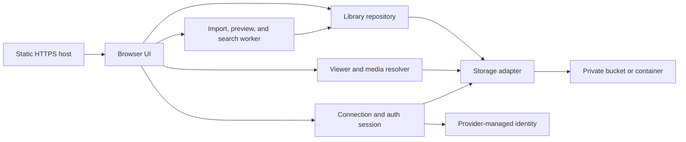

# Minnelux

**Product requirements document**

## 1. Product and scope

Build Minnelux, an open-source web app for people who want to browse, search, and organize a private photo and video archive in cloud storage they own. The owner deploys a static HTTPS site, connects a private bucket or container, imports media, and can open the same library from a fresh browser. The browser handles authentication, indexing, editing, and media viewing. Object storage holds the originals, previews, source metadata, catalog, and persisted inverted index.

The deployment consists of static app files and library objects. The app calls cloud storage and provider-managed identity services directly. The owner configures storage access and any required OAuth or identity registration. The static host can be separate from the private bucket. Publish the source, static build, versioned file formats, and self-hosting instructions.

The first release opens one library at a time, with one portable library per bucket or container prefix. Tags are named collections. A photo or video can belong to any number of tags without duplicating the original. Initial media support covers common browser-decodable photo and video formats. Background phone backup, external sharing, manual album ordering, and semantic search are future scope.

## 2. Requirements and acceptance criteria

| Requirement | Acceptance criteria |
| --- | --- |
| **R1. Connect private storage** | The static app can initialize and reopen a private library on Google Cloud Storage, Azure Blob Storage, Amazon S3, and Cloudflare R2. A user with read-only access can browse and search. An unauthorized session cannot read library objects. Connection errors identify credential, permission, or browser cross-origin problems where the provider exposes enough information. |
| **R2. Import photos and videos** | The owner can upload local files or catalog existing objects under a selected prefix. Uploaded originals retain their bytes. Existing objects stay in place. Imports report progress and individual errors, and retries reuse asset identities. |
| **R3. Import a Flickr archive** | The owner can supply metadata and media parts across sessions. A preview shows matched, pending, ambiguous, and duplicate items before writing. A match preserves the original bytes and relevant raw JSON. Available titles, descriptions, tags, capture times, coordinates, and album memberships become usable library metadata. Reimporting a part preserves owner edits and existing memberships. |
| **R4. Organize with tags** | The owner can create and rename tags, apply or remove them on one or many assets, and open a collection from the tag browser or an asset. A photo or video with two tags appears in both collections by reference to one asset. Renaming a tag preserves membership and searchability. The browser includes All Media and Untagged. |
| **R5. Search** | Search queries the persisted inverted index from the bucket. It supports words in filenames, titles, descriptions, and tag names, plus filters for tags, media type, and date. A fresh authorized browser can search without listing the media prefix or indexing originals. Results belong to the same published revision as the catalog. |
| **R6. Browse previews** | A responsive thumbnail grid presents All Media, a tag collection, and search results. The grid defaults to capture-date order outside ranked search. It fetches visible thumbnails or posters and shows placeholders where needed. Originals are fetched on demand. |
| **R7. View photos and videos** | A full-screen viewer supports image zoom, video playback and seeking, and keyboard, touch, and on-screen navigation. It displays title, date when known, and tags. Returning to the grid restores the current collection or query and scroll position. Unsupported formats retain a download path. |
| **R8. Reopen, repair, and migrate** | A fresh browser can reopen the library and see saved edits. The owner can rebuild search from the catalog. Copying the library and referenced originals to another supported provider preserves IDs, tags, and search results after connection setup and any media-root remapping. |

## 3. Browser architecture



| Component | Responsibility |
| --- | --- |
| **Connection and auth session** | Selects a provider, obtains credentials, validates permissions, and manages expiration and disconnect. Supplies a storage adapter authorized for the selected library. |
| **Storage adapter** | Defines paginated listing, object metadata, reads and range reads, uploads, and conditional writes. Returns provider revisions as opaque tokens. Normalizes errors such as missing object, expired session, and failed write precondition. |
| **Library repository** | Loads and pins a revision, resolves relative object keys, publishes catalog and index snapshots, and handles retries and concurrent edits. |
| **Import and preview pipeline** | Adapts local files, existing objects, and Flickr export parts into asset records. Previews a Flickr join and processes imports in bounded batches. Generates image thumbnails and video posters in the browser when the source can be decoded. |
| **Search worker** | Builds compact token and tag postings, reads the persisted index, and returns ordered asset IDs for the current filters. Rebuilds the index from the catalog when requested. |
| **Gallery and viewer** | Provides tag navigation, search, virtualized thumbnails, bulk tagging, and full-screen photo and video viewing. Resolves media using the active session and the viewer's pinned result list. |

Implement a static TypeScript single-page app. Lazy-load the selected provider adapter. Run parsing, preview generation, and indexing in browser workers where supported. Reuse fetched catalog and index data in browser memory for the authorized session. Consider persistent private caching only if measured performance calls for it.

### Storage providers and authentication

| Provider | Browser authentication and storage API | Conditional head write |
| --- | --- | --- |
| **Google Cloud Storage** | Obtain a short-lived Google OAuth access token through Google Identity Services. Call the native Cloud Storage JSON API using the signed-in Google account's IAM permissions. | Object generation precondition. Use `ifGenerationMatch=0` to create the head and the observed generation to update it. |
| **Azure Blob Storage** | Obtain an Azure Storage access token with Microsoft Entra ID and MSAL Browser. Use a single-page app registration with authorization code and PKCE. Azure data-plane RBAC grants access to the container. | `If-None-Match: *` to create, or `If-Match` using the current blob ETag to update. |
| **Amazon S3** | Obtain temporary AWS credentials through a configured Cognito identity pool after sign-in. Scope the role to the selected bucket and any required prefixes. | Conditional PUT using `If-None-Match: *` or the current ETag in `If-Match`. |
| **Cloudflare R2** | Use S3 request signing against the R2 endpoint. The owner supplies bucket-scoped S3 credentials for the session. Accept externally issued temporary S3 credentials when available. | Conditional PUT using `If-None-Match: *` or the current ETag in `If-Match`. |

Use a dedicated static origin and a Content Security Policy that allows the required identity and storage endpoints. Keep tokens, signing credentials, and signed URLs in memory and out of logs. Persist only non-secret connection settings. For Azure, S3, and R2, document the cross-origin rules and headers needed by the browser. GCS JSON API endpoints use Google's default CORS response headers. Validate the response headers required by media reads on the actual endpoint. [GCS CORS](https://docs.cloud.google.com/storage/docs/cross-origin) · [Azure CORS](https://learn.microsoft.com/en-us/rest/api/storageservices/Cross-Origin-Resource-Sharing--CORS--Support-for-the-Azure-Storage-Services) · [S3 CORS](https://docs.aws.amazon.com/AmazonS3/latest/userguide/cors.html) · [R2 CORS](https://developers.cloudflare.com/r2/buckets/cors/)

The provider adapters use native optimistic write preconditions. The deployment guide covers provider registration, IAM and data-plane roles, and connection setup for each adapter. [GCS preconditions](https://docs.cloud.google.com/storage/docs/request-preconditions) · [Entra Blob authorization](https://learn.microsoft.com/en-us/azure/storage/blobs/authorize-access-azure-active-directory) · [Azure blob concurrency](https://learn.microsoft.com/en-us/azure/storage/blobs/concurrency-manage) · [Cognito temporary credentials](https://docs.aws.amazon.com/cognito/latest/developerguide/amazon-cognito-integrating-user-pools-with-identity-pools.html) · [S3 conditional writes](https://docs.aws.amazon.com/AmazonS3/latest/userguide/conditional-writes.html) · [R2 credentials](https://developers.cloudflare.com/r2/api/tokens/) · [R2 conditional writes](https://developers.cloudflare.com/r2/api/s3/conditional-operations/)

### Google account sign-in and GCS access

Register a Google OAuth web application client with each deployed site's exact authorized JavaScript origin and configure its consent screen. Self-hosters can register their own OAuth client ID. For a personal Gmail account, use an external audience and add the owner as a test user while the app is in Testing. The owner also needs Cloud Storage IAM access to the bucket. Grant Storage Object Viewer for listing and reading, or a bucket-scoped write role such as Storage Object User for importing and publishing edits. Public distribution is subject to Google's publishing and verification requirements. [Google OAuth client registration](https://developers.google.com/identity/oauth2/web/guides/get-google-api-clientid) · [OAuth audience settings](https://support.google.com/cloud/answer/15549945?hl=en) · [Cloud Storage IAM roles](https://docs.cloud.google.com/storage/docs/access-control/iam-roles)

On a user click, the Google Identity Services token client opens Google's account and consent dialog and returns an OAuth access token to the browser. Request `devstorage.read_only` for browsing or `devstorage.read_write` for editing. Set `include_granted_scopes: false` for a read-only request and check the granted scope before enabling writes. OAuth scopes govern operations, and IAM governs which resources the token can access. The browser sends `Authorization: Bearer <access-token>` to the Cloud Storage JSON API. For example, `GET /storage/v1/b/{bucket}/o/{encoded-object}?alt=media` returns private object bytes when the scope and bucket IAM both allow it. Google hosts the identity flow. The app uses its public OAuth client ID and serves static files. Use the returned expiration to prompt for renewal. Request a replacement token through a new user action when needed. [Google browser token model](https://developers.google.com/identity/oauth2/web/guides/use-token-model) · [Token client options](https://developers.google.com/identity/oauth2/web/reference/js-reference#datatype-tokenclientconfig) · [Cloud Storage OAuth scopes](https://docs.cloud.google.com/storage/docs/oauth-scopes) · [Authenticated object reads](https://docs.cloud.google.com/storage/docs/json_api/v1/objects/get)

### Private media delivery

Fetch thumbnails and image bytes directly using the session. For S3 and R2, use short-lived browser-generated presigned GETs for video. For GCS and Azure, validate a same-origin Service Worker route that uses an access token from the active tab to relay byte-range requests inside the browser. Bind the route to the authorized tab, selected library, registered asset ID, and configured provider endpoint. Preserve the media type, `206` status, and range information required by the player. Set the correct media type on video objects and serve their raw bytes without gzip content encoding so GCS can honor byte ranges. A token expiration pauses the request if reauthorization is needed. After the user reconnects, resume or reopen the video at the prior position. A supported video must be able to start and seek without downloading the whole original first. [HTTP range requests](https://developer.mozilla.org/en-US/docs/Web/HTTP/Guides/Range_requests) · [GCS media GET](https://docs.cloud.google.com/storage/docs/json_api/v1/objects/get) · [GCS range and transcoding](https://docs.cloud.google.com/storage/docs/transcoding#using-the-range-header) · [Azure Get Blob](https://learn.microsoft.com/en-us/rest/api/storageservices/get-blob) · [S3 presigned URLs](https://docs.aws.amazon.com/AmazonS3/latest/userguide/using-presigned-url.html) · [R2 presigned URLs](https://developers.cloudflare.com/r2/api/s3/presigned-urls/)

## 4. Library format

| Record | Fields and behavior |
| --- | --- |
| **Asset** | Stable library ID, source references, original object reference, filename, media kind, optional title, plain-text description, capture time, location, preview references, and tag IDs. An original reference contains a logical media root, relative key, MIME type, byte size, and an optional observed provider version used for change detection. |
| **Tag** | Stable library ID, display name, and optional source reference. The same asset carries multiple tag IDs. Imported Flickr album and keyword identities are namespaced separately, including when their display names match. |
| **Import state** | Source account key, stable source item IDs, references to preserved photo and album JSON, and pending or unresolved matches. Store enough state in the library to continue when additional media or metadata parts arrive. |

```text
library/
  head.json                            current revision and format version
  revisions/<revision-id>.json         immutable snapshot references
  catalog/<content-id>.json.gz         asset records and tag dictionary
  index/text/<content-id>.json.gz      normalized term to asset postings
  index/tags/<content-id>.json.gz      tag ID to asset postings
  previews/<asset-id>/<content-id>     immutable image or video previews
  sources/flickr/<source-key>/...      raw photo and album JSON and import state
  originals/...                        uploaded media
```

The manifest references the catalog, both postings objects, and the import state for its revision. Library metadata uses relative object keys. Existing objects can sit under a configured media root in the same bucket or container. Preserve the observed version separately from the asset ID. Flag missing or replaced objects on read or explicit rescan. After provider migration, validate the copied media and record new provider versions. Export the library prefix and any referenced originals outside it.

### Flickr reconciliation

- **Join by source identity.** Validate each metadata filename against its payload ID where available. Match media using the Flickr ID in a recognized export filename suffix, such as `_<id>_o` before the extension, scoped to the source account. Treat source IDs as strings and inspect file signatures when determining media type. Keep the `original` URL as provenance. Review ambiguous and duplicate matches before linking them. Ordinary local imports can detect retries with a strong digest, and existing-object imports use the logical root and key.
- **Handle partial exports.** Present joined, metadata-only, media-only, ambiguous, and duplicate items separately. Keep metadata and album memberships for media that has yet to arrive. Media with a recognized source ID can be linked when its metadata is later supplied. Repeated imports reuse the same asset and fill untouched metadata fields. Record applied source memberships so additional parts can add newly discovered memberships while respecting tags the owner removed.
- **Use album IDs for memberships.** For albums present in `albums.json`, take membership from the `photos` arrays. Use identifiable per-item album entries as a fallback for albums absent from the album document. Surface disagreements and unresolved album IDs. Preserve the raw album JSON, including its member order and references to media still awaiting import. Map album IDs to tag IDs. Treat Flickr keywords as a separate tag source.
- **Normalize with provenance.** Retain the embedded EXIF and raw source values. Preserve capture time without inventing a timezone, and keep any observed offset and precision. Capture time and Flickr import time are separate fields. Decode integer-string Flickr coordinates as signed microdegrees for the supported export profile, range-check the result, and retain unknown values in raw source data. Convert markup-bearing descriptions into safe plain text. Resolve embedded EXIF orientation and Flickr display rotation together when generating previews or rendering media. [Flickr export documentation](https://www.flickrhelp.com/hc/en-us/articles/4404079675156-Downloading-content-from-Flickr) · [Flickr EXIF FAQ](https://www.flickrhelp.com/hc/en-us/articles/4404078521108-EXIF-data-FAQ)

## 5. Search and publication

### Persisted inverted index

Store compressed snapshots of text postings and tag postings. Use sorted integer ordinals into the catalog array within each revision. Asset IDs remain stable across revisions. The text index records which assets contain each normalized term in filename, title, or description, with simple field weights for ranking. Apply the same Unicode, case, and accent normalization to queries and indexed values.

On opening a library, load the head and catalog. Fetch tag postings for collections and load text postings on the first text query. For each query term, combine matches in the text index with assets in tags whose current name matches the term. Intersect sets across terms and selected tag filters. Then apply media type and date filters. Rank text results by match score with a stable date and asset ID tie-breaker. Browse views sort by capture time when known with a stable fallback to added time. Interpret offset-free capture dates as recorded calendar values across devices.

The catalog is authoritative. Stamp the index and tokenizer versions in the manifest. If an index is missing, damaged, or unsupported, keep catalog browsing available and offer a browser-side rebuild. Compare measured snapshot download, build, and publish times with release targets before introducing pages, shards, or incremental index storage.

### Publish and recover a revision

1. Read and revalidate the head. Prepare a batch against the observed provider revision. Assign an operation ID and preserve a bounded set of recent operation receipts.
2. Upload new originals, previews, and source objects as needed. Write the immutable catalog and index snapshots and their manifest. Reuse unchanged snapshots when their ordinals and data still match. Previously published objects stay available.
3. Update the head with the provider's conditional write. Readers pin one revision for a query or viewer sequence. Reload the head when opening or refreshing the library. If another writer publishes first, reload and reapply independent edits. Show conflicting field changes for owner resolution.
4. If the response is interrupted, reread the head and use operation receipts and stable source identity to reconcile before retrying. Retain objects referenced by published revisions. Cleanup of abandoned and obsolete objects is a separate maintenance workflow.

## 6. Release validation and implementation order

### 1. Prove the browser-only architecture

Use a minimal deployed static HTTPS page and real private test storage. The app must call provider identity and storage endpoints directly, with no app backend.

- **GCS sign-in and publication.** Sign in through Google Identity Services with a personal Gmail account granted bucket IAM. Verify private reads, authorized uploads and conditional revision publication, denied publication in a read-only session, and denied reads for a signed-in account without bucket IAM. Replace an expired token through user action and resume playback at the prior position.
- **Private video and storage contract.** In desktop and mobile Safari, play and seek authenticated GCS and Azure video via same-origin Service Worker routes. Confirm the upstream requests return `206` with usable range headers and the browser can seek before downloading the full original. Verify browser-generated presigned playback and seeking for S3 and R2. On all four providers, record required CORS behavior, read-only and expired or revoked credential behavior, conditional head creation and updates, and rejection of stale writes.
- **Independent spikes.** In parallel, build a sanitized multipart Flickr fixture and exercise the identity join and merge across arrival orders and repeat imports. Benchmark loading, building, and publishing compressed catalog and index snapshots for a representative 50,000-item library. Use the measurements to decide whether the proposed snapshot format fits the release targets before committing to it.

Pass the sign-in, private media, and storage contract checks before starting full UI implementation. Resolve any failed browser-only path within the static architecture and rerun its check. Use the Flickr merge and snapshot results before fixing those interfaces.

### 2. Build the GCS reference workflow and parallel integrations

Build one deployed GCS workflow from local upload or existing-object import through preview, bulk tagging, browse, persisted search, full-screen viewing, and fresh-browser reopen. Include interrupted publication and retry, concurrent edits, and index repair. Use this workflow as the reference for the other providers.

Once the storage, catalog, and search interfaces are agreed, Azure, S3, and R2 adapters can each run the storage contract checks independently. The Flickr importer can build on the fixture and asset/import-state interface while gallery and viewer work uses fixture-backed catalog, search, and media interfaces. Integrate each track into the reference workflow as its dependency is ready.

### 3. Validate and release all four providers

- **Provider parity.** From the deployed static build, run the same reference workflow on private storage for GCS, Azure, S3, and R2 on current Chromium, Firefox, and Safari, including mobile Safari. Verify authorized and read-only access, expired and revoked credentials, two tags on one asset, fresh-browser search, video seeking, interrupted and concurrent publication, and index repair. Inspect network requests to confirm direct provider access. Exercise migration to another supported provider and verify stable IDs, tags, and search results. Claim parity only after all four providers pass.
- **Flickr acceptance.** Verify filename and payload IDs, out-of-order parts, unmatched and ambiguous items, duplicate names, overlapping albums, offset-free dates, markup descriptions, signed microdegree coordinates, EXIF orientation, and Flickr rotation. Use real photo and video fixtures. Confirm that repeat imports preserve asset identity and owner edits.
- **Performance acceptance.** Measure after authorization on a midrange mobile device at 20 Mbps and 80 ms round-trip latency with a representative 50,000-item library. Target p95 of 3 seconds to the first visible thumbnails, 1 second to the first page of a cold text query, and 250 ms for a warm query. Record request counts, transferred bytes, and sample size. Measure browser index building and publishing separately from query latency.

Provider runs, Flickr acceptance, and performance measurement can proceed in parallel once their integrated workflows are available. Publish after the gates pass and the codec matrix, open-source license, and self-hosting instructions are ready.
